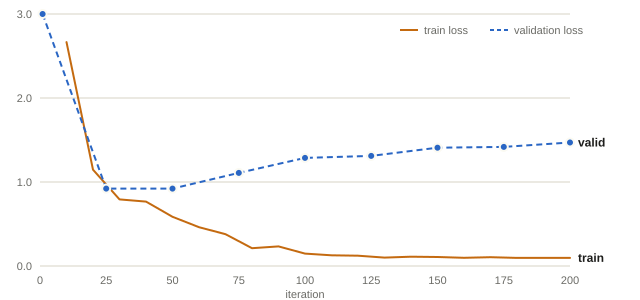
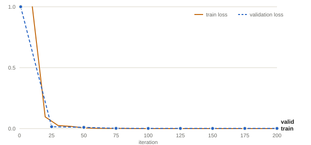

- [Large Language Models (LLMs)](#large-language-models-llms)
  * [Links](#links)
  * [Skills](#skills)
  * [Ollama](#ollama)
    + [Characteristics](#characteristics)
    + [Commands](#commands)
  * [MLX](#mlx)
    + [Local Agentic AI Stack](#local-agentic-ai-stack)
    + [MLX community](#mlx-community)
    + [Libraries and servers](#libraries-and-servers)
  * [Paramters](#paramters)
    + [Temperature](#temperature)
    + [Top-K](#top-k)
    + [Top-P](#top-p)
  * [Prompt engineering](#prompt-engineering)
    + [Tips](#tips)
  * [Google AI Edge Gallery](#google-ai-edge-gallery)
    + [Agent Skills](#agent-skills)
  * [Inferencing](#inferencing)
  * [Basic theory](#basic-theory)
  * [Low-Rank Adaptation (LoRA)](#low-rank-adaptation-lora)
    + [MLX specifics](#mlx-specifics)
  * [Unsloth](#unsloth)
    + [Commands (Mac)](#commands-mac)
____

# Large Language Models (LLMs)

## Links

- [ollama/ollama](https://github.com/ollama/ollama)
- [models](https://ollama.com/library)
- [infiniflow/ragflow](https://github.com/infiniflow/ragflow) - a
  Retrieval-Augmented Generation engine
- [parakeet-nest/parakeet](https://github.com/parakeet-nest/parakeet) - a GoLang
  library, made to simplify the development of small generative AI applications
  with Ollama; [documentation](https://parakeet-nest.github.io/parakeet/)
- [open-webui/open-webui](https://github.com/open-webui/open-webui) - a web
  interface for Ollama
- [alexhokl/ollama-rag](https://github.com/alexhokl/ollama-rag)
- [alexhokl/ollama-image](https://github.com/alexhokl/ollama-image)
- [llm-ollama](https://github.com/taketwo/llm-ollama) - a plugin for Python
  program `llm` to interact with Ollama

## Skills

- [The Agent Skills Directory](https://skills.sh/)
- [Agent Skills Marketplace - Claude, Codex & ChatGPT Skills | SkillsMP](https://skillsmp.com/)
- [google/skills: Agent Skills for Google products](https://github.com/google/skills/tree/main)
- [flutter/skills](https://github.com/flutter/skills)
- [dart-lang/skills](https://github.com/dart-lang/skills)
- [google-ai-edge gallery skills README](https://github.com/google-ai-edge/gallery/blob/main/skills%2FREADME.md)

## Ollama

### Characteristics

- `gemma3`
  * although the context window is large, bias towards beginning of the context
    is noticeable and it leads to wrong answer in case of question asked on
    a specific part of context
  * prompts written in Japanese but response is return in English
  * translation from Japanese Kenji to Kana is not very accurate
  * vision
    + the orientation and resolution of an image matters
      + examples
        + words in a rotated image cannot be recognised correctly
        + words may not be recognised correctly if the resolution is too high
          but the words are relative small in the image
    + some Japanese words are not recognised correctly such as Kana
    + it could not read Japanese written vertically

### Commands

##### To pull Docker image

```sh
docker pull docker.io/ollama/ollama:latest
```

##### To run ollama server on Docker

```sh
docker run -d -v ollama:/root/.ollama -p 11434:11434 --name ollama ollama/ollama
```

- by default, it runs command `ollama serve`
- it creates a docker volume named `ollama` to store the model files

##### To run ollama server on Mac

```sh
brew services start ollama
```

##### To allow other machines accessing the server

```sh
OLLAMA_HOST=0.0.0.0:11434 ollama serve
```

##### To use a remote instance

```sh
OLLAMA_HOST=https://example.com/ollama ollama run gemma:2b
```

assuming port `11434` is used

##### To pull a model

```sh
ollama pull llama3
ollama pull llama3:70b
ollama pull gemma:2b
ollama pull gemma:7b
```

##### To list models available locally

```sh
ollama list
```

##### To show context length

```sh
ollama show llama3.1:8b
```

##### To start a chat bot

```sh
ollama run llama3
```

##### API usage

```sh
curl http://localhost:11434/api/generate -d '{
  "model": "llama3",
  "prompt":"What is TCP/IP?"
}'
```

```sh
xh post http://localhost:11434/api/generate model=llama3 prompt="What is TCP/IP?"
```

##### Summarise a code file

```sh
ollama run llama3 "Summarise $(cat /Users/someone/main.go)"
```

##### To create a modelfile from a model

```sh
ollama show llama3 --modelfile > llama3.modelfile
```

##### To creata a model with a modelfile

```sh
ollama create custom_model --modelfile llama3.modelfile
```

## MLX

### Local Agentic AI Stack

- Local agent
  * Xcode, Opencode, Pi
-	MLX-LM Server
  * Ollama, LM Studio, [vLLM](https://vllm.ai/)
-	MLX-LM
-	MLX

### MLX community

- [mlx-community on Hugging Face](https://huggingface.co/mlx-community)
- [models from mlx-community](https://huggingface.co/mlx-community/models?sort=downloads)

### Libraries and servers

- [ml-explore/mlx-lm](https://github.com/ml-explore/mlx-lm) - text only
- [Blaizzy/mlx-vlm](https://github.com/Blaizzy/mlx-vlm) - vision (VLM) and audio
  and video (Omni models)
- [Blaizzy/mlx-audio](https://github.com/Blaizzy/mlx-audio) - audio only
  * not all models available from `mlx-community` on Hugging Face are supported

#### Commands

##### To transscribe an audio

```sh
mlx_audio.stt.generate --model mlx-community/whisper-large-v3-turbo-asr-fp16 --language zh-yue --audio audio.wav --output-path script
```

and option `langauge` is only needed when there are multiple languages involved
in the audio. Otherwise, the model will automatically detect the language.

Extension `.txt` is automatically added to the output file name.

##### To generate speech from text

```sh
mlx_audio.tts.generate --model mlx-community/Qwen3-TTS-12Hz-0.6B-Base-bf16 --text "$(cat text)" --output_path .
```

Note that option `--output_path` is a specification of a directory.

Note that most of the options highly depending on the model used. For instance,
`gender` or `voice` may not be available for some models and will be silently
ignored.

## Paramters

### Temperature

Temperature `0` implies the process creates deterministic outcomes.

A higher temperature implies the process allows creation of outcomes with lower
probabilities.

### Top-K

If `top-K` is set to `3`, the model picks from the first 3 choices in terms of
probability.

### Top-P

If `Top-P` is set to `0.7`, the model would select words with probability of
`0.3` and higher.

## Prompt engineering

In prompt engineering, ask the model to indicate if it is not sure about the
answer (where the probability is low). Such as "Answer 'I am not sure' if you
are not sure about answer)

In prompt engineering, role playing is a way to give context to the model.

### Tips

- mathematical problems
  * break it down for the model by asking the questions in smaller pieces
- give example
- take advantage of chat history (hence, giving more context)
- currently, models understand programming language better than human languages
- for a conversation requires more than the maximum number of tokens of a model,
  a trick can be used is that to ask the model to summarise the conversation so
  far and store the summary to database storage and replay it later.

## Google AI Edge Gallery

### Agent Skills

- `SKILL.md` inside a kebab-case folder (`some-skill-name`)
- skill types
  * text-only
  * [JavaScript](https://github.com/google-ai-edge/gallery/blob/main/skills/README.md#javascript-js-skills)
    + logic runs in a hidden webview via `window['ai_edge_gallery_get_result']`
      in `scripts/index.html`; can return text, base64 image or inline webview
  * native
    + uses `run_intent` tool (e.g. `send_email`, `send_text_message`);
      new intents require app source code changes

#### Installation

##### Transfer from a local machine

```sh
adb push my-js-skill/ /sdcard/Download/
```

In Google AI Edge Gallery app,

Agent Skills use case
-> `Skills` chip
-> `(+)` button
-> `Import local skill`
-> pick the folder containing `SKILL.md`

##### Pull from web

- host the skill folder on a URL and use `Load skill from URL`

## Inferencing

- parallisms
  * data parallelism
  * pipeline parallelism
  * tensor parallelism
  * expert parallelism
    + for MoE (Mixture of Experts) models, only a subset of experts are used for
      each input, hence the model is more efficient and faster
- prefill/decode disaggregation
  * prefill
    + process input prompt in parallel using a fixed set of model weights to
      compute the KV cache for the decoder
    + compute-bound
    + TTFT (time to first token)
      + the time taken to generate the first token of the response
      + an indicator of performance of prefill process
  * decode
    + to build a response using the whole KV cache
    + memory-bound
    + ITL (Inter-token latency)
      + the time taken to generate each token of the response
      + an indicator of performance of decode process
  * KV cache
    + buffer between prefill and decode

## Basic theory

Reference: [Language Model Builder](https://languagemodelbuilder.com/)

- ngram
  * unigram has no context
    + it only asks which words are common anywhere in the text
  * bigram uses one previous word, such as `little -> cat`
  * trigram uses two, such as `the little -> cat`
- the model only ever has odds
  * temperature controls how adventurously it picks, with low values
    concentrating probability around the likeliest word
  * temperature changes the sampling distribution after those probabilities
    exist
    + `adjusted_weight(word) = P(word)^(1/T)`
- older models either see only a small fixed window or squeeze the past through
  a sequential running state
  * the transformer addressed both limitations
    + attention created direct paths to earlier tokens, and
    + its training computations could run in parallel across positions
- attention
  * each token is first turned into a list of numbers called a vector.
  * the model then makes three small projections of that vector,
    + query
      + what this token is looking for
    + key
      + what this other token offers
    + value
      + the information this other token can contribute
  * for every permitted pair of positions, the model compares the query from one
    token with the key from another
    + if they line up, the attention score is high
    + if they do not, the score is low
    + those scores are turned into weights, and the model uses them to blend
      together the value vectors from relevant earlier tokens
    + after attention runs, each token’s vector has been updated with a weighted
      mixture of information from the context it was allowed to see
- tokenization
  * before attention can compare vectors, the raw text has to be chopped into
    pieces and assigned identifiers, and models don’t chop at word boundaries;
    their unit of meaning is the token: maybe a whole word, maybe part of one,
    maybe a punctuation mark or a bit of whitespace
  * tokenization is the bridge between human text and model math
  * common words can become one token, while rare words can be split into
    familiar pieces
  * byte-pair encoding (BPE) tokenizer works by running merges over enormous
    amounts of text and it could start with character-level tokens
    + count adjacent pairs, merge the most frequent one, repeat
- each token maps to a vector
- a LLM model embeds vectors
  * through training, vector of tokens such as "cat" and "dog" will drift closer
    together and further away from "Paris" or "Rome"
  * vectors can be used for computation
    + `king` - `man` + `woman` = `queen` (approximately)
      + besides `queen` the resultant vector should be close to `daughter` and
        `princess`
  * whether two vectors are close or far away can be measured by cosine of the
    angle between them
  * besides token embedding, there are also positional embedding to help model
    to understand the order of tokens in a sequence (or the order of words in a
    sentence)
    + in modern LLMs, rotary positional embeddings (RoPE) are used instead of
      absolute positional embeddings
      + it rotates the vectors used when tokens compare themselves with one
        another (such as "three tokens back" instead of "slot 7")
    + the position (be it asolute or relative) determines the angle of rotation
      to the token embedding vector
- transformer
  * reading vectors and computes predictions for the next token
  * it is a pipeline
    + tokenise and embed
    + run the blocks
      + a block is one repeating unit of the machine
        + also known as a transformer block, or a layer
        + a fixed bundle of arithmetic that takes in the sequence of vectors and
          hands back the same sequence, slightly improved
        + it lets the tokens exchange information with each other, then does a
          bit of processing on each token alone
    + normalise and score
      + after the last block, one final normalisation tidies up the numbers, and
        then a final procjection called the output head gives every token in the
        vocabulary a score for how likely it is to be the next token
    + turn scores into odds
      + squashes the scores into probabilities that sum to 1
  * attention
    + each token asks a question (its query), each token advertises what it has
      to offer (its key), and where a question and an offer line up, information
      (the value) flows
    + it all happens as a handful of big matrix multiplications
    + causal attention
      + the model is only allowed to look backward
    + runs as several parallel conversations at once
      + each conversation is called an attention head
      + each head gets its own learned slices of the queries, keys, and values,
        so each is free to detect different relationships
        + it allows parallelism
      + after all the heads have done their looking, their results are stitched
        back together into one vector per token
    + it is the only place in the entire model where tokens interact with each
      other
  * components of neural network
    + weight matrix
      + a linear layer mixes a a vector’s entries using a grid of learned
        numbers
    + activation function
      + a non-linear function which is a fixed rule applied to each number
        between two linear layers
        + something like "if it’s negative, squash it"
  * multi-layer perceptron (MLP)
    + also known as feedforward network
    + a stack of linear layers and activation functions
    + while attention moves information (vectors) between positions, MLP
      transforms information at each position
    + optimisations to allow multiple layers
      + residual connections
        + the model adds the sublayer’s output onto the vector it already had
      + normalisation
        + each sublayer gets a small operation right before its input that takes
          a vector and rescales it to a consistent, well-behaved range
          + it earns its place because numbers flowing through a deep stack of
            multiplications like to drift, some exploding and some collapsing
            toward zero, and once they drift far enough, training falls apart
    + for each block
      + normalisation -> attention -> normalisation -> MLP
  * hyperparameters
    + number of layers (or blocks) to stack
      + more blocks means more rounds of refinement and more capacity for
        complicated patterns
    + width
      + how many numbers are in each vector
    + number of attention heads
      + how many parallel attention conversations run in each block, splitting
        the width between them
    + context length
      + how many tokens the model can look back over
    + vocabulary size
      + how many distinct tokens and it determines the size of the embedding
        table and output head
- in the context of mixture of experts (MoE) models, active parameters can be
  interpreted as how many parameters take part for each token
- checkpoint
  * a snapshot of every model parameter
  * it is written to disk
  * it also carries the running state of optimizer and a little metadata such as
    the training step, model shape, tokenizer, and data source
  * it allows training to be paused and resumed
- loss
  * a measure of how well the model is doing
  * training is about minimising loss
  * compute using the probability of the correct next token
  * cross-entropy from Claude Shannon’s information theory
  * gradient descent is an algorithm to minimise loss
    + learning rate determines how far it moves downhill in each step
      + too low it will take forever to reach the bottom
      + too high it will overshoot and bounce around
  * the more training completed, the lower the loss in general
    + when validation loss starts to rise, the model is overfitting
- behaviour learning
  * post-training processes
    + supervised finetuning (SFT)
      + gives the model example after example
      + for example, if the model sees that shape often enough, it’ll start
        treating it as the natural thing to do — so that later, when you prompt
        it with a `<|user|>` turn, answering as a helpful `<|assistant|>` is
        simply what it expects to come next
      + the model is shown the whole exchange instead of just part of a text
        + loss is only measured on the answer part (not the question part)
      + suitable for teaching shapes such as formats, styles, and routines
        + it cannot fill the gaps in board knowledge or reasoning abilities in
          the base model
    + direct preference optimization (DPO)
      + show two answers and human pointing to the better one
      + it is an alternative to reinforcement learning from human feedback
        (RLHF)
      + two models involved
        + one is a freezed base model
        + the other is a diverged model (from the freezed base model)
      + iterate with the following questions to find the loss
        + How much more likely is the chosen answer now than under the frozen
          copy?
        + How much more likely is the rejected answer now than under the frozen
          copy?
      + the frozen copy is used to act as an anchor to prevent the diverged
        model from drifting into some strange text

## Low-Rank Adaptation (LoRA)

- `h = Wx + α/r * BAx`

- LoRA matrices
  * base model `W`
    + example
      + for a typical attention matrix in a 7B-class mode, `d` and `k` are both
        `4096`, so the weight matrix has `16.7M` parameters
  * matrix `A` starts with small random values and matrix `B` starts with zeros
    + this is used for step 1 of the training and thus `BxA` is initially zero and
      the model behaves like the base model
    + the product of `BxA` has the same shape as `W` and it is named as
      "adapter"
  * `r` is the rank of the LoRA matrices
    + typically `8` or `16`
  * `x` is the input vector
  * `α` is a scaling factor
  * size of the matrix is `r * (d + k)`
- typical size of attention layer

| Model Parameter Scale | Dimensions     | Typical layers | Total attention parameters |
| --- | --- | --- | --- |
| Small (1B – 3B)       | 4096 x 4096 | 16 | 16*4*4096*4096 = 1.07B |
| Standard (7B – 8B)    | 5120 x 5120 | 64 | 64*4*5120*5120 = 6.71B |
| Large (70B – 72B)     | 8192 x 8192 | 80 | 80*4*8192*8192 = 21.5B |

- use of LoRA allows adapting a model to handle a specific task without giving a
  very specific instruction to the model as system prompt
- data leakage
  * validation data includes training data
  * the model answers by memorising instead of generalising
- overfitting
  * the model memorises the training data so closely that it fails to make
    correct predictions on new data
- genrealisation
  * making good predictions on data it has not seen
- prompt masking
  * to ask the loss function to ignore the prompt part of the training data and
    only focus on the answer part of the training data
  * importance
    + to avoid wastes capacity updating its LoRA parameters to learn to predict
      the prompt itself
    + to avoid overfitting on inputs
      + `"System: You are an assistant..."`
- typical number of layers (blocks) by model size

| Model Parameter Scale | Typical Number of Layers | Representative Examples      |
| --------------------- | ------------------------ | ---------------------------- |
| Small (1B – 3B)       | 16 to 32 layers          | Llama 3.2 (1B/3B), Qwen 0.6B |
| Standard (7B – 8B)    | 32 layers                | Llama 3/3.1 8B, Mistral 7B   |
| Mid-Range (13B – 14B) | 40 layers                | Llama 2 13B, Qwen 14B        |
| Upper-Mid (30B – 34B) | 60 layers                | Qwen 32B, CodeLlama 34B      |
| Large (70B – 72B)     | 80 layers                | Llama 3/3.1 70B, Qwen 72B    |

- typical matrices in a layer
  * q_proj (attention)
  * k_proj (attention)
  * v_proj (attention)
  * o_proj (attention)
  * gate_proj (feed-forward)
  * up_proj (feed-forward)
  * down_proj (feed-forward)

### MLX specifics

To create a virtual environment for training

Note: The version used here is just an example.

```sh
pyenv local 3.11.15
python -m venv .venv
source .venv/bin/activate
pip install "mlx-lm[train]"
```

To test if the virtual environment is set up correctly

```sh
mlx_lm.generate --model Qwen/Qwen2.5-0.5B-Instruct --prompt "In one sentence, why the sky is blue?"
```

The training is provided in form of JSONL files. The following is an example
line.

```json
{"messages": [{"role": "user", "content": "Ordered a size M, received an XL."}, {"role": "assistant", "content": "{\"label\": \"wrong_item\"}"}]}
```

Right before training, `mlx-lm` converts each JSONL line to chat template of the
model. For example,

```
<|im_start|>system
You are Qwen, created by Alibaba Cloud. You are a helpful assistant.<|im_end|>
<|im_start|>user
Ordered a size M, received an XL.<|im_end|>
<|im_start|>assistant
{"label": "wrong_item"}<|im_end|>
```

To start training

```sh
mlx_lm.lora --model Qwen/Qwen2.5-0.5B-Instruct --train --data data --adapter-path adapters --iters 200 --steps-per-eval 25 --save-every 25
```

where `data` is the directory containing the JSONL files and `adapters` is
directory storing the generated LoRA adapters, `iters` is the total number of
iterations (as the default batch size is `4`, the total number of training
example used will be `4 * 200 = 800`), `steps-per-eval` is the number of
iterations before evaluation, and `save-every` is the number of iterations
before saving the LoRA adapters.

The command outputs training loss and evaluation loss.



From the above curve, overfitting is observed after iteration `50`.

To test the adapters

```sh
mlx_lm.generate --model Qwen/Qwen2.5-0.5B-Instruct --adapter-path adapters --prompt "Lid cracked and the tea leaked all over the other items."
```

To train with prompt masking, use `--mask-prompt`.

```sh
mlx_lm.lora --model Qwen/Qwen2.5-0.5B-Instruct --train --data data --iters 200 --steps-per-eval 25 --save-every 25 --mask-prompt --adapter-path adapters-masked
```



A YAML file can be specified (`--config`) for passsing configration. The
following are the default values.

```yaml
num_layers: 16        # how many layers get an adapter, counted from the top

lora_parameters:      # the indented lines below belong to this group
  rank: 8             # r: the narrow inner size of A and B
  scale: 20.0         # multiplies B·A directly (mlx-lm has no alpha)
  dropout: 0.0        # randomly ignores some inputs during training; 0 = off
```

#### Creating Ollama modelfile from LoRA adapters

- general steps
  * fuse adapter into weights using `mlx_lm.fuse`
  * convert to GGUF file using converter of `llama.cpp`
  * create `Modelfile` points to GGUF file

Create a fused model from the LoRA adapters

```sh
mlx_lm.fuse --model Qwen/Qwen2.5-0.5B-Instruct --adapter-path adapters-masked --save-path fused
```

Check the fused model

```sh
mlx_lm.generate --model fused --prompt "Tins arrived dented and two have burst open."
```

To convert to GGUF

```sh
git clone --depth 1 https://github.com/ggml-org/llama.cpp.git tools/llama.cpp
python -m venv .venv-gguf
.venv-gguf/bin/pip install -r tools/llama.cpp/requirements/requirements-convert_hf_to_gguf.txt
cp -L ~/.cache/huggingface/hub/models--Qwen--Qwen2.5-0.5B-Instruct/snapshots/*/{tokenizer_config.json,tokenizer.json,vocab.json,merges.txt} fused/
.venv-gguf/bin/python tools/llama.cpp/convert_hf_to_gguf.py fused --outfile complaint-labeller-q8_0.gguf --outtype q8_0
```

Create a `Modelfile` like the following

```
FROM ./complaint-labeller-q8_0.gguf
TEMPLATE """{{- if .System }}<|im_start|>system
{{ .System }}<|im_end|>
{{ end }}{{- range .Messages }}<|im_start|>{{ .Role }}
{{ .Content }}<|im_end|>
{{ end }}<|im_start|>assistant
"""
SYSTEM """You are Qwen, created by Alibaba Cloud. You are a helpful assistant."""
PARAMETER stop <|im_end|>
PARAMETER temperature 0
```

To build the model

```sh
ollama create complaint-labeller -f Modelfile
```

To run the model

```sh
ollama run complaint-labeller "Ordered oat milk, received almond milk."
```

## Unsloth

- an open-source fine-tuning library
- Nvidia `cuda`
  * uses PyTorch, PEFT, TRL and Unsloth's Triton kernels
- Mac
  * uses FastMLXModel and `mlx-lm`
- quantization from 16-bit to 4-bit does not drop memory usage in inferencing to
  one quarter as embedding table stays at 16 bits
- Unsloth notebook
  * load
  * attach an adapter
  * build a trainer
  * train
- comparing `mlx-lm` and `unsloth` parameters

| mlx-lm | Unsloth |
|---|---|
| `--model Qwen/…` | `FastLanguageModel.from_pretrained(…, load_in_4bit=False)` |
| `rank: 8` | `get_peft_model(r=8)` |
| `scale: 20` | `lora_alpha=160` (Unsloth uses `lora_alpha / r`, so 20 × 8) |
| `--num-layers 16` (the default) | `finetune_last_n_layers=16` |
| `--iters 200` | `max_steps=200` |
| `--batch-size 4` | `per_device_train_batch_size=4`, `gradient_accumulation_steps=1` |
| `--save-every 25` · `--steps-per-eval` | `save_steps=25` · `eval_steps=25` |
| `--mask-prompt` | `train_on_responses_only(trainer, …)` |

- effective batch size = `per_device_train_batch_size * gradient_accumulation_steps`
- 16-bit weight can take any of 64k values, while 4-bit weight can take only 16
  values
- MLX works on groups of 64 weights
  * each group stores a scale (the step between levels) and a bias (where the
    levels start), 16 bits each
  * theoretical bits per weight
    + for 8-bit quantization, `8 + (16+16)/64 = 8.5` (`1.0625` bytes per weight)
    + for 4-bit quantization, `4 + (16+16)/64 = 4.5` (`0.5625` bytes per weight)
    + for 3-bit quantization, `3 + (16+16)/64 = 3.5` (`0.4375` bytes per weight)
    + for 2-bit quantization, `2 + (16+16)/64 = 2.5` (`0.3125` bytes per weight)
  * memory requirement
    + (embedding + head) x 2 bytes + (total number of weights - (embedding + head)) x bytes per weight
      + as embedding and head are not quantized, they are stored in 16 bits (2
        bytes) per weight
    + for a `0.5B` model
      + `(151936 x 896 + 0) x 2 + 358M x 0.5625 = 474MB`
        + where `151936` is number of rows (vocabulary) in the embedding table,
          `896` is the number of columns of embedding table, `0` is head size
          where, in case of `Qwen2.5-0.5B-Instruct`, it is shared with embedding
          table, `358M` is roughly the total number of weights minus the
          embedding table and head size
      + actual bits per weight = `474MB * 8 / 494M = 7.67`
        + it is reported in the training
      + the larger the model, the close the actual bits per weight to the
        theoretical bits per weight
    + for a `7B` model
      + `(151936 x 3584 + 151936 x 3584) x 2 + 5.6B x 0.5625 = 5.85GB`
        + `5.6B` is roughly the total number of weights minus the embedding
          table and head size
      + actual bits per weight = `5.85GB * 8 / 7.62B = 6.15`

### Commands (Mac)

##### To create a virtual environment and install Unsloth

```sh
uv venv --python 3.12 .venv
uv pip install --python .venv/bin/python "unsloth==2026.10.7"
source .venv/bin/activate
```

Note: Pinning the version avoids a long dependency resolution with an unpinned
`unsloth`.

##### To check the installed packages

```sh
uv pip list | grep -E "^(unsloth|mlx|mlx-lm|torch|peft|trl) "
```

##### To download a model into the Hugging Face cache

```sh
hf download Qwen/Qwen2.5-7B-Instruct
```

##### To load a model and generate a reply

On a Mac, Unsloth returns an `mlx-lm` model, so `mlx_lm.generate` works on it.

```python
from unsloth import FastLanguageModel
from mlx_lm import generate

model, tokenizer = FastLanguageModel.from_pretrained(
    "Qwen/Qwen2.5-0.5B-Instruct",  # or a directory of adapters
    max_seq_length=512,
    load_in_4bit=False,  # default is True (MLX 4-bit, group 64)
)
prompt = tokenizer.apply_chat_template(
    [{"role": "user", "content": "Ordered oat milk, received almond milk."}],
    tokenize=False, add_generation_prompt=True,
)
print(generate(model, tokenizer, prompt=prompt, max_tokens=40))
```

Passing an adapter directory (such as `adapters-unsloth`) instead of a model
name loads its base model and attaches the adapter.

##### To train a LoRA adapter (equivalent of `mlx_lm.lora --mask-prompt`)

`unsloth` must be imported before `trl`, as it replaces `SFTTrainer` and
`SFTConfig` with its MLX versions on import. Importing `trl` first results in
errors such as `ValueError: adamw is not a valid OptimizerNames`. Add
`# isort: split` to stop import sorters from reordering them.

```python
from unsloth import FastLanguageModel, train_on_responses_only

# isort: split
from datasets import load_dataset
from trl import SFTConfig, SFTTrainer

model, tokenizer = FastLanguageModel.from_pretrained(
    "Qwen/Qwen2.5-0.5B-Instruct", max_seq_length=512,
    load_in_4bit=False,  # True = QLoRA
)
model = FastLanguageModel.get_peft_model(
    model,
    r=8,
    lora_alpha=160,  # lora_alpha / r = mlx-lm scale 20
    finetune_last_n_layers=16,  # Unsloth's default is all layers
    target_modules=["q_proj", "k_proj", "v_proj", "o_proj",
                    "gate_proj", "up_proj", "down_proj"],
    random_state=0,
)

def to_text(rows):
    return {"text": [tokenizer.apply_chat_template(m, tokenize=False)
                     for m in rows["messages"]]}

data = load_dataset(
    "json", data_files={"train": "data/train.jsonl", "valid": "data/valid.jsonl"}
).map(to_text, batched=True)

trainer = SFTTrainer(
    model=model,
    tokenizer=tokenizer,
    train_dataset=data["train"],
    eval_dataset=data["valid"],
    args=SFTConfig(
        max_steps=200,
        per_device_train_batch_size=4,
        gradient_accumulation_steps=1,  # Unsloth's default on Mac is 4
        learning_rate=1e-5,
        lr_scheduler_type="constant",  # Unsloth's default is "linear"
        warmup_steps=0,  # Unsloth's default is 5
        optim="adam",  # Unsloth's default is "adamw"
        weight_decay=0.0,
        cast_norm_output_to_input_dtype=False,  # default True stops Qwen2.5-7B learning on Mac
        logging_steps=10,
        eval_steps=25,
        save_steps=25,
        output_dir="adapters-unsloth",
        seed=0,
    ),
)
trainer = train_on_responses_only(
    trainer,
    instruction_part="<|im_start|>user\n",
    response_part="<|im_start|>assistant\n",
)
trainer.train()
```

- the output directory contains the final adapter and `checkpoint-N`
  sub-directories, each of which can be loaded with `from_pretrained`
- a QLoRA adapter always re-quantises its base model to 4 bits when loaded
  (even with `load_in_4bit=False`)
- peak memory of training Qwen2.5-7B (16 layers, rank 8): QLoRA `8.4GB`, 16-bit
  LoRA `32.2GB`

##### To set up llama.cpp for GGUF export without Unsloth installing anything

By default, Unsloth downloads or builds `llama.cpp` into `~/.unsloth` and may
try to install system packages. Instead, provide a local copy with
`llama-quantize` from Homebrew.

```sh
brew install llama.cpp
git clone --depth 1 https://github.com/ggml-org/llama.cpp.git tools/llama.cpp
ln -s "$(which llama-quantize)" tools/llama.cpp/llama-quantize
```

##### To export an adapter to GGUF

Fuse, convert and quantise in a single call. The two environment variables must
be set before `unsloth` is imported.

```python
import os
os.environ["UNSLOTH_LLAMA_CPP_PATH"] = os.path.abspath("tools/llama.cpp")
os.environ["UNSLOTH_AUTO_INSTALL"] = "0"
from unsloth import FastLanguageModel

model, tokenizer = FastLanguageModel.from_pretrained(
    "adapters-unsloth", max_seq_length=512, load_in_4bit=False
)
model.save_pretrained_gguf(
    "exports/complaint-0.5b", tokenizer, quantization_method="q8_0"
)
```

- the file is named after the base model and the format, such as
  `exports/complaint-0.5b/Qwen2.5-0.5B-Instruct.Q8_0.gguf`
- it briefly needs disk space for the 16-bit intermediate (about `15GB` for a
  7B model)
- bits per weight
  * `q8_0`: blocks of 32 weights with one 16-bit scale,
    `8 + 16/32 = 8.5`
  * `q4_k_m`: about `4.9`
- export a QLoRA adapter at `q8_0`, not `q4_k_m`
  * the adapter was trained on MLX's 4-bit rounding of the base weights, and
    `q4_k_m` rounds the merged weights again with a different scheme
  * Qwen2.5-7B QLoRA adapter scored 29/30 in Python, 21/30 at `q4_k_m` and
    29/30 at `q8_0`
  * a 16-bit-trained adapter at `q4_k_m` scored 30/30
  * always test the exported file, not just the adapter

##### To build and test the model in Ollama

Use the `Modelfile` from [MLX specifics](#mlx-specifics) with `FROM` pointing at
the exported GGUF file.

```sh
ollama create complaint-labeller-unsloth -f Modelfile
ollama run complaint-labeller-unsloth "Ordered oat milk, received almond milk."
```
