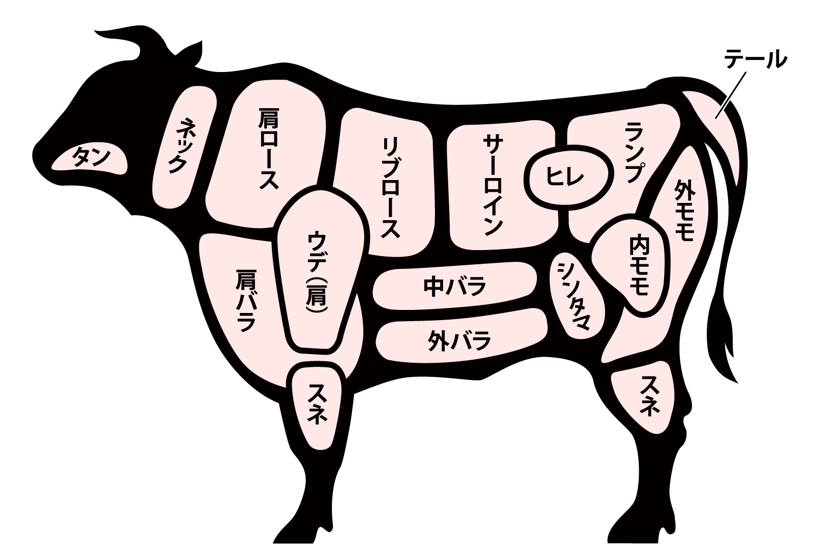
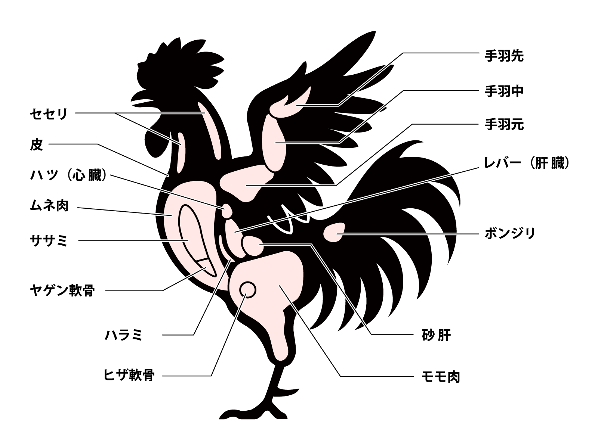

# 肉の部位 (にくのぶい) - cuts of meat

## 豚肉 (ぶたにく) - pork

- source: [豚肉 ロースと肩ロースと肩の違い](https://ryouribiyori.com/differences-in-pork-parts/)

- ミミ - ear
- カシラ - head; cheek
- タン - tongue
- ネック - neck
- 肩ロース (かたロース) - shoulder loin; Boston butt
- 肩肉 (かたにく) - shoulder
- 腕肉 (うでにく) - picnic shoulder
- ロース - loin
- ヒレ - tenderloin; fillet
- 中バラ (なかバラ) - middle belly
- 外バラ (そとバラ) - outer belly
- モモ - leg; ham
- 外モモ (そともも) - outside ham
- スネ - shank
- 豚足 (とんそく) - trotter; pig's feet
- テール - tail

## 牛肉 (ぎゅうにく) - beef

- source: [牛肉 カルビとバラ肉って違うの？](https://ryouribiyori.com/differences-in-beef-parts/)

- タン - tongue
- ネック - neck
- 肩ロース (かたロース) - chuck roll; shoulder loin
- 肩バラ (かたバラ) - brisket; shoulder belly
- ウデ - shoulder clod; aka 肩 (かた)
- リブロース - rib loin; ribeye
- サーロイン - sirloin
- ヒレ - tenderloin; fillet
- ランプ - rump
- 中バラ (なかバラ) - middle belly; short plate
- 外バラ (そとバラ) - outer belly; flank
- シンタマ - knuckle; round tip
- 内モモ (うちもも) - top round; inside round
- 外モモ (そともも) - bottom round; silverside
- スネ - shank
- テール - tail; oxtail

## 鶏肉 (とりにく) - chicken

- source: [鶏肉 もも肉とむね肉の違い](https://ryouribiyori.com/difference-between-chicken-breast-and-thigh/)

- セセリ - neck meat
- 皮 (かわ) - skin
- ハツ - heart; aka 心臓 (しんぞう)
- ムネ肉 (むねにく) - breast
- ササミ - breast tenderloin
- ヤゲン軟骨 (ヤゲンなんこつ) - keel cartilage; breastbone cartilage
- ハラミ - diaphragm; belly meat
- ヒザ軟骨 (ヒザなんこつ) - knee cartilage
- 手羽先 (てばさき) - wing tip
- 手羽中 (てばなか) - mid-wing; wingette
- 手羽元 (てばもと) - drumette
- レバー - liver; aka 肝臓 (かんぞう)
- ボンジリ - parson's nose; tail
- 砂肝 (すなぎも) - gizzard
- モモ肉 (ももにく) - thigh; leg
