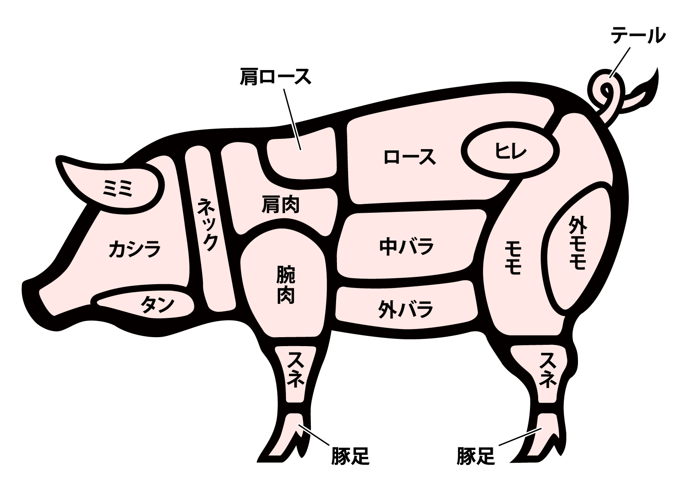

# 肉の部位 (にくのぶい) - cuts of meat

## 豚肉 (ぶたにく) - pork

- source: [豚肉の部位の違い](https://ryouribiyori.com/differences-in-pork-parts/)

- ミミ - ear
- カシラ - head; cheek
- タン - tongue
- ネック - neck
- 肩ロース (かたロース) - shoulder loin; Boston butt
- 肩肉 (かたにく) - shoulder
- 腕肉 (うでにく) - picnic shoulder
- ロース - loin
- ヒレ - tenderloin; fillet
- 中バラ (なかバラ) - middle belly
- 外バラ (そとバラ) - outer belly
- モモ - leg; ham
- 外モモ (そともも) - outside ham
- スネ - shank
- 豚足 (とんそく) - trotter; pig's feet
- テール - tail
